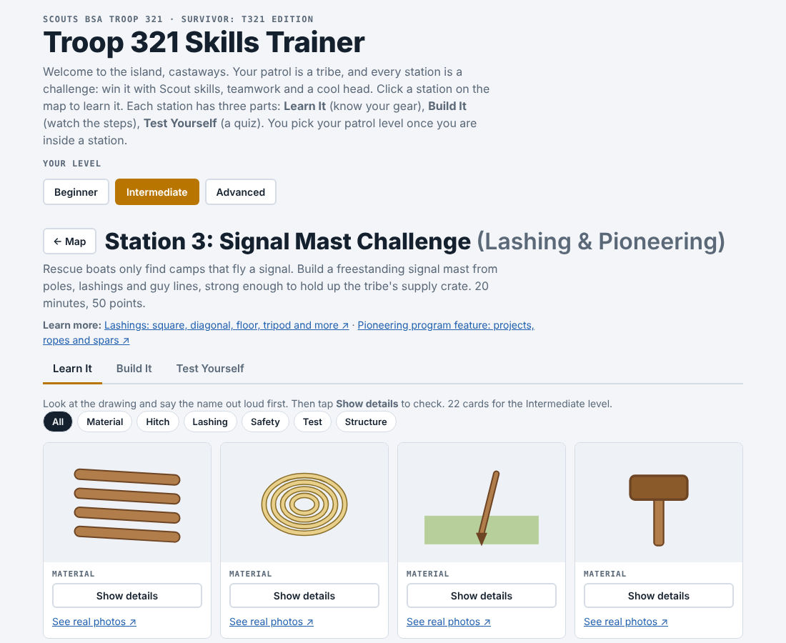

# Troop 321 Skills Trainer

**Survivor: T321 Edition: a mobile-friendly practice trainer for Scouts BSA Troop 321.**
Each patrol is a tribe and each skill station is a challenge. Scouts learn the stations at home and test themselves before the patrol competition. Every station adapts to three patrol levels: **Beginner**, **Intermediate** and **Advanced**.

**Live trainer:** https://samerhaj.github.io/troop321-skills-trainer/

## What it does

A scout walks an island map through the skill stations. Every station has the same three parts:

| Part | What the scout does |
|---|---|
| **Learn It** | Flashcards with a drawing of each tool, item or technique. Say the name out loud, then tap **Show details** to check. A link opens real photos in a new tab. |
| **Build It** | Animated, step-by-step scenes for the task, a "what the judge checks" list, skill tips from the Troop Leader Resources, and a practice clock set to the station's time limit. |
| **Test Yourself** | A 17-question knowledge quiz on the station's skills, grouped by the station's rubric lines and drawing on the Troop Leader Resources pages. Instant feedback with a short explanation, a score by rubric line, a review list of misses, and a reshuffled retake. |

Requirements and scoring differ by level, so the steps, judge checklist, time limit and quiz all change with the level the scout picks.

| Learn It | Build It |
|---|---|
|  |  |

| Test Yourself | Score by rubric line |
|---|---|
|  |  |

## Skill stations

| # | Skill | Station |
|---|---|---|
| 1 | Fire building | Hot Cocoa Reward Challenge |
| 2 | Knife, axe and saw (Totin' Chip) | Tribe Camp Build Challenge |
| 3 | Knots (Scout, Tenderfoot, Second Class and First Class rank knots) | Shipwreck Rope Challenge |
| 4 | Lashing and pioneering | Signal Mast Challenge |
| 5 | First aid | Medevac First Aid Challenge |
| 6 | Poisonous plants, snakes and critters (identification, first aid, encounters) | Jungle Trek Hazard Challenge |
| 7 | Orienteering (map and compass) | Hidden Treasure Hunt |
| 8 | Orienteering (estimating height) | Lookout Tower Height Challenge |

More stations will be added over time.

Each station shows its skill name in the title and on the map, and links to Scouting America's Troop Leader Resources for that skill.

## Resources

Skill references linked from the stations ([Troop Leader Resources](https://troopleader.scouting.org/)):

- Merit badge pamphlets (Scouting America): [First Aid](https://filestore.scouting.org/filestore/Merit_Badge_ReqandRes/Pamphlets/First%20Aid.pdf), [Pioneering](https://filestore.scouting.org/filestore/Merit_Badge_ReqandRes/Pamphlets/Pioneering.pdf), [Orienteering](https://filestore.scouting.org/filestore/Merit_Badge_ReqandRes/Pamphlets/Orienteering.pdf), [Cooking](https://filestore.scouting.org/filestore/Merit_Badge_ReqandRes/Pamphlets/Cooking.pdf), [Camping](https://filestore.scouting.org/filestore/Merit_Badge_ReqandRes/Pamphlets/Camping.pdf) (all pamphlets: [scouting.org merit badges](https://www.scouting.org/skills/merit-badges/all/)), plus the [Wilderness First Aid Curriculum and Doctrine Guidelines](https://filestore.scouting.org/filestore/pdf/680-008.pdf). Learn It cards cite their printed page numbers. Where sources disagree, the merit badge pamphlet wins.
- Scouting America articles and activities: [Scout Life: 3 ways to lay a campfire](https://scoutlife.org/outdoors/178473/3-different-ways-to-lay-the-firewood-for-a-campfire/), [Scout Life: Tips to build a fire](https://scoutlife.org/outdoors/1327/trail-tips-build-a-fire/), [Scouting magazine: How to build the best campfire](https://scoutingmagazine.org/2016/02/how-to-build-the-best-campfire/), [The stick method](https://www.scouting.org/cub-scout-activities/stick-method/), [Measure distance by counting steps](https://scoutlife.org/outdoors/outdoorarticles/165500/), [Scout Basic Essentials](https://www.scouting.org/cub-scout-activities/scout-basic-essentials/)
- Map symbols: [USGS Topographic Map Symbols](https://www.usgs.gov/media/files/topographic-map-symbols)

- Fire building: [Fire Building](https://troopleader.scouting.org/rank-advancement-skills/campcraft/fire-building/), [NPR: Summer Science, How To Build A Campfire](https://www.npr.org/2012/06/04/154162859/summer-science-how-to-build-a-campfire)
- Orienteering: [Orienteering program feature](https://troopleader.scouting.org/program-features/orienteering/), [Navigation and Measurements](https://troopleader.scouting.org/rank-advancement-skills/campcraft/navigation-and-measurements/)
- Knife, axe and saw: [Scouting America: Totin' Chip](https://www.scouting.org/awards/awards-central/totin-chip/), [Troop Leader Resources: Woods tools](https://troopleader.scouting.org/rank-advancement-skills/campcraft/woods-tools/), [Troop 60: Knife, axe and saw skills](https://www.troop60.co/resources/scout-skills/knife-axe-and-saw-skills), and Scout Life articles on [the ax](https://scoutlife.org/outdoors/157237/how-to-use-an-ax-to-chop-wood/), [sharpening an ax](https://scoutlife.org/outdoors/outdoorarticles/2247/how-to-sharpen-an-ax/) and [camp saws](https://scoutlife.org/video-audio/146361/how-to-use-a-camp-saw/); content also from Troop 321's own Totin' Chip card and woods-tools handouts
- Knots: [Troop Leader Resources: Basic knots](https://troopleader.scouting.org/rank-advancement-skills/campcraft/basic-knots/), [Scouts BSA rank requirements (2025)](https://www.scouting.org/wp-content/uploads/2026/02/3321625-Scouts-BSA-Requirements.pdf) and [Animated Knots: Scouting knots](https://www.animatedknots.com/scouting-knots)
- Lashing and pioneering: [Lashings](https://troopleader.scouting.org/rank-advancement-skills/pioneering/lashings/), [Pioneering program feature](https://troopleader.scouting.org/program-features/pioneering/information/), and step-by-step lashing and hitch animations from [Animated Knots](https://www.animatedknots.com/scouting-knots)
- First aid: [First Aid program feature](https://troopleader.scouting.org/program-features/first-aid/information/)
- Poisonous plants, snakes and critters: [First Aid merit badge pamphlet](https://filestore.scouting.org/filestore/Merit_Badge_ReqandRes/Pamphlets/First%20Aid.pdf) and the Reptile and Amphibian Study merit badge pamphlet (cited, not linked), [Scouts BSA rank requirements](https://www.scouting.org/wp-content/uploads/2026/02/3321625-Scouts-BSA-Requirements.pdf) (Tenderfoot 4a–4d, Second Class 6a–6c), [Guide to Safe Scouting: Animal and insect hazards](https://www.scouting.org/health-and-safety/gss/gss13/), [Scouting magazine: Found a tick?](https://onscouting.org/2026/07/02/found-a-tick-heres-what-to-do/), CDC pages on [venomous snakes](https://www.cdc.gov/niosh/outdoor-workers/about/venomous-snakes.html), [poisonous plants](https://www.cdc.gov/niosh/outdoor-workers/about/poisonous-plants.html), [venomous spiders](https://www.cdc.gov/niosh/outdoor-workers/about/venomous-spiders.html), [insects and scorpions](https://www.cdc.gov/niosh/outdoor-workers/about/insects-and-scorpions.html), [tick removal](https://www.cdc.gov/ticks/media/pdfs/2025/07/CDC_Tick_Removal_Fact_Sheet.pdf) and [bite prevention](https://www.cdc.gov/fight-the-bite/prevent/index.html), [Mayo Clinic: Animal bites](https://www.mayoclinic.org/first-aid/first-aid-animal-bites/basics/art-20056591), National Park Service [bear](https://www.nps.gov/subjects/bears/safety.htm) and [mountain lion](https://www.nps.gov/articles/mountain-lion-safety.htm) safety, [Leave No Trace: Respect wildlife](https://lnt.org/why/7-principles/respect-wildlife/), [Oregon State Extension: hemlocks](https://extension.oregonstate.edu/pests-diseases/weeds/poison-hemlock-western-water-hemlock-deadly-plants-may-be-growing-your-pasture) and [NY DEC: Giant hogweed](https://dec.ny.gov/sites/default/files/2026-05/ghposter.pdf)
- Measuring heights: [Navigation and Measurements](https://troopleader.scouting.org/rank-advancement-skills/campcraft/navigation-and-measurements/) (measuring heights and widths)

## How it was built

- **One self-contained HTML file.** No server, no install, no tracking. It also works offline once saved.
- **Data-driven design.** Each station is a data object (items, steps, scoring rubric, question bank) rendered by one shared engine, so adding a station means adding data, not new code.
- **Inline SVG animation** for every drawing and build step, with `prefers-reduced-motion` respected and light and dark themes.
- **Quiz scoring follows the rubric.** Each question's weight is its rubric line's points divided by the number of questions on that line. Math questions use new random numbers on every retake.
- **Built with AI assistance** (Claude), directed and reviewed by the troop leader.

## Adding a station

Everything lives in `index.html`. Use an existing station (for example `ST.s4`, First Aid) as the template.

1. **Map entry.** Add the station's name, `skill` name, `res` (learn-more links) and map icon to `NINFO`, then add its id to `ORDER` and `LIVE`. Map positions and station numbers are worked out from `ORDER`, so reordering that array reorders the map. An id in `ORDER` but not in `LIVE` shows as a locked "coming soon" stop.
2. **Station data.** Define `ST.<id>` with `name`, `scenario`, `time`, `goal`, `judge`, `items` (Learn It cards), `cats` (rubric lines and their points per level), `qb` (question bank), and `steps` (Build It scenes).
3. **Levels.** Level keys are `T` (Beginner), `W` (Intermediate) and `B` (Advanced). They are internal ids only; `lv:'TWB'` means "all levels", `lv:'WB'` means Intermediate and Advanced. Display names live in one place, the `LV` object.
4. **Ids are permanent.** Saved best scores are stored per station id, so never reuse or renumber an old id. That is why the fifth station's id is `s6`: the original Station 5 was removed.

## Limits and notes

- Drawings are practice sketches, not photos or videos of real hands. Real stations may differ; always follow the judge's briefing.
- Scores are an estimate of the rubric, a knowledge check rather than a real competition score.
- This is an unofficial troop study aid, not affiliated with or endorsed by Scouting America. The Survivor theme is a troop event theme, not affiliated with the TV show.

## Credits and history

- Forked from **[camporee-trainer](https://github.com/haythamHKA/camporee-trainer)** by **Haytham Hassan**, built for Troop 321G at the 8th Annual Girl Camporee of the East Coast ("Back to the Future").
- The original station requirements, rubrics and scoring came from that camporee's **2026 Leader Guide**. This version re-themes the stations as Survivor: T321 Edition for Troop 321 (replacing the camporee's "Back to the Future" story), renames the patrol levels (Trailblazers → Beginner, Woodsmen → Intermediate, Bushmasters → Advanced), drops the plumbing station, and has every fire-station material at the station. Stations will be revised and expanded over time, so content here may no longer match the original guide.

## Author

Samer El-Haj-Mahmoud
