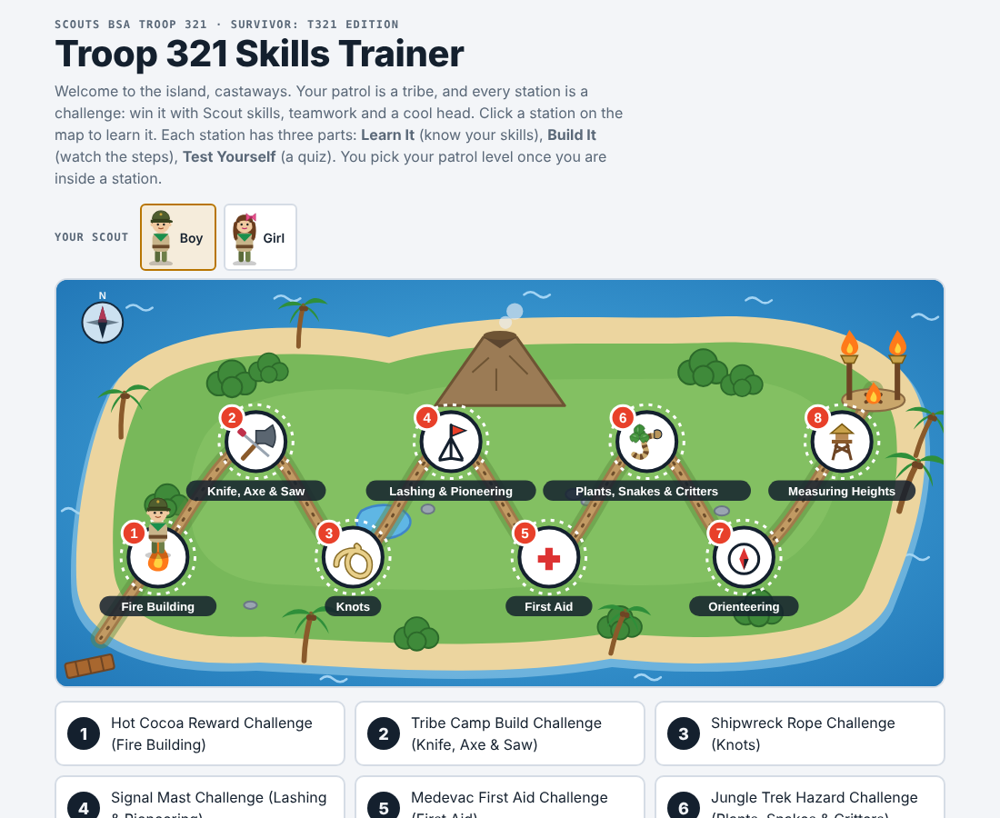
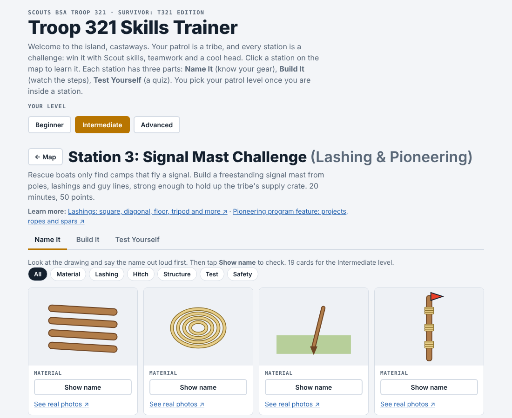
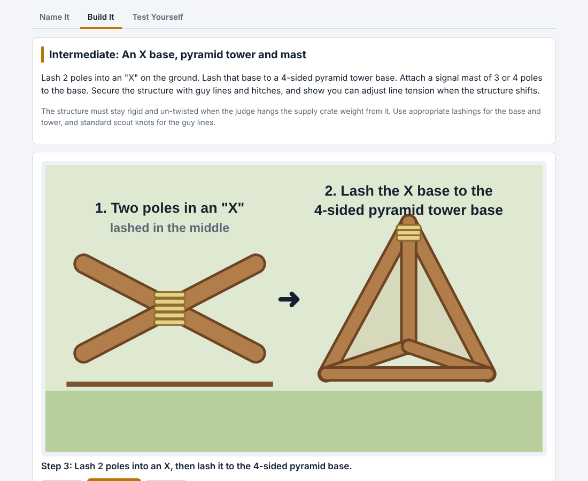
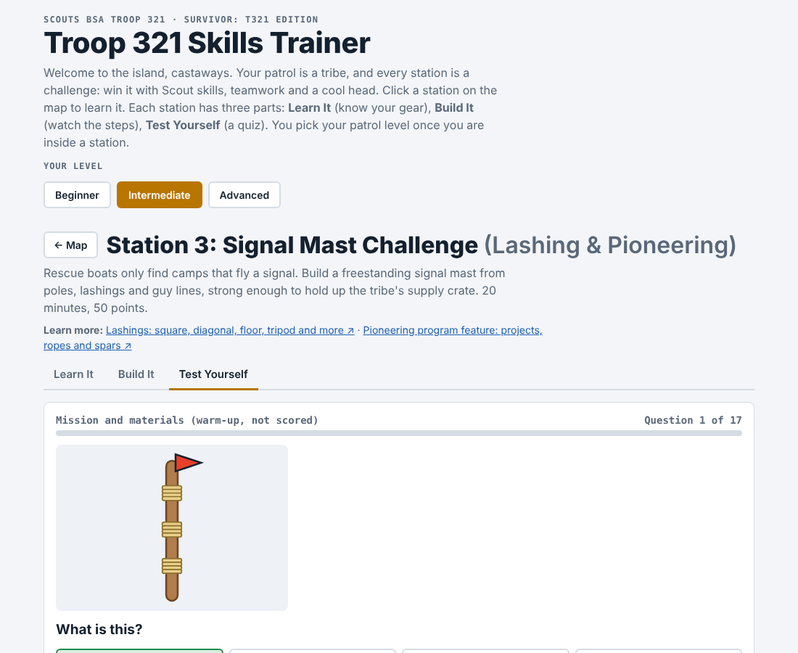
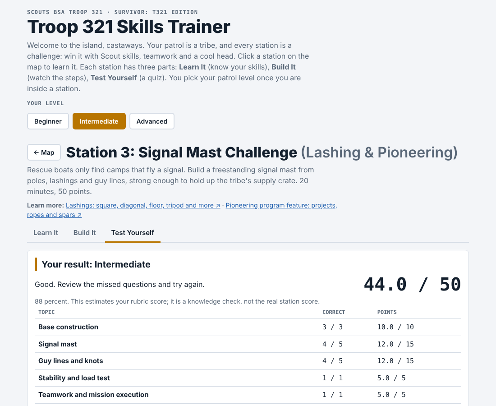

# Camporee Skills Trainer

**A mobile-friendly practice trainer for Scouting America Troop skills**
Built for Scouting Troops with three different patrol levels, so scouts can learn each the skill at home and test themselves during patrol competitions.

**Live trainer:** 

## What it does

A scout walks a Mario-style map through six competition stations. Every station has the same three parts:

| Part | What the scout does |
|---|---|
| **Name It** | Flashcards with a drawing of each tool or item. Say the name out loud, then tap to check. A link opens real photos in a new tab. |
| **Build It** | Animated, step-by-step scenes for the task, a "what the judge checks" list, and a practice clock set to the station's time limit. |
| **Test Yourself** | A 17-question quiz built only from the station's scoring rubric. Instant feedback with a short explanation, a score by rubric line, a review list of misses, and a reshuffled retake. |

Each station adapts to the patrol's level (Beginner, Intermediate, or Advanced), because the requirements and the scoring differ by level.

| Name It | Build It |
|---|---|
|  |  |

| Test Yourself | Score by rubric line |
|---|---|
|  |  |

## The skills stations

1. Campfire : Hot Cocoa Fire Lab
2. Orienteering: Hill Valley Coordinate Shift
3. Lashings: Lightning Rod Collector Tower
4. First Aid: Emergency First Aid
5. (Orienteering - Object height): Clock Tower Height Estimator

## How it was built

- **One self-contained HTML file.** No server, no install, no tracking. It also works offline once saved.
- **Data-driven design.** Each station is a data object (items, steps, scoring rubric, question bank) rendered by one shared engine, so adding a station means adding data, not new code.
- **Inline SVG animation** for every drawing and build step, with `prefers-reduced-motion` respected and light and dark themes.
- **Quiz scoring rubric.** Each question's weight is its rubric line's points divided by the number of questions on that line. Math questions use new random numbers on every retake.
- **Built with AI assistance** (Claude), directed and reviewed by the troop leader.

## Limits and notes

- Drawings are practice sketches, not photos or videos of real hands. Real stations may differ; always follow the judge's briefing.
- Scores are an estimate of the rubric, a knowledge check rather than a real competition score.
- This is an unofficial troop study aid, not affiliated with or endorsed by Scouting America.

## Author

Samer El-Haj-Mahmoud
Adapted from Haytham Hassan's camporee-trainer https://github.com/haythamHKA/camporee-trainer/

